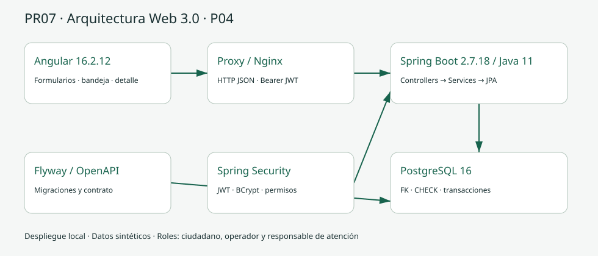
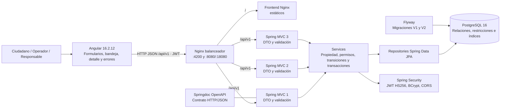
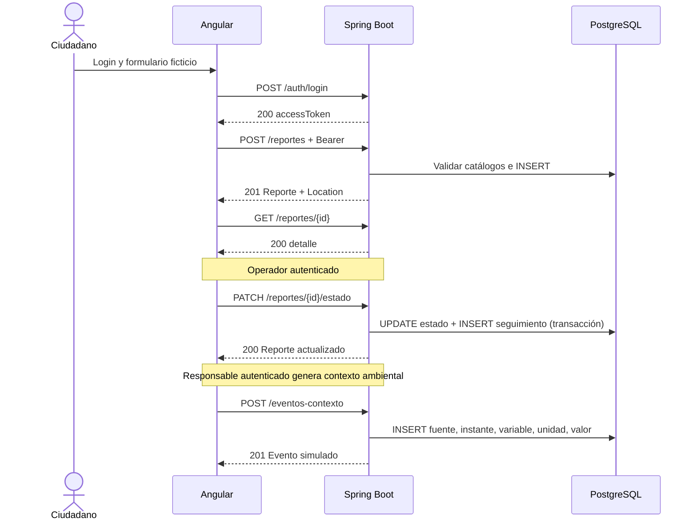

# Arquitectura · P04 / M04 / PR07

## Problema y alcance

Las incidencias comunitarias ficticias necesitan prioridad, evidencia y seguimiento. El flujo principal registra una incidencia, la revisa, la atiende y la cierra con historial persistido. Hay exactamente tres roles: ciudadano, operador y responsable de atención. PR07 se toma del documento proporcionado.

## Componentes y despliegue

Angular nunca consulta SQL ni decide permisos definitivos. Controllers traducen HTTP a DTO; servicios verifican identidad, propiedad, catálogos y reglas. Repositorios persisten entidades; PostgreSQL asegura integridad. El Nginx balanceador sirve el frontend estático y reparte `/api/`, la salud y la documentación entre tres instancias sin estado; todas comparten la misma base y el mismo secreto JWT. Compose utiliza una red privada con IP fijas para PostgreSQL, backends y frontend, y publica solo el balanceador en loopback. Variables de entorno externalizan secretos. El seed demo es idempotente para tolerar el arranque simultáneo de las tres instancias. Maven Wrapper fija Maven 3.9.9 para el backend y el perfil `e2e` ejecuta Playwright dentro de Docker, de modo que el host no requiere Maven ni Node.

## Decisiones justificadas y alternativas

| Decisión | Motivo y consecuencia | Alternativa considerada |
| --- | --- | --- |
| Angular con componentes standalone y HttpClient | Formularios declarativos, estado de carga y errores HTTP explícitos; cliente separado y compilable | JSP reduce despliegues pero mezcla ciclo de presentación con servidor; no cumple arquitectura Angular solicitada |
| Spring Boot 2.7.18 y Java 11 | Cumple restricción M04. El original Boot 3.5.7/Java 21 fue adaptado: javax, DTO inmutables compatibles con 11, Streams y seguridad | Boot 3 requiere Java 17+ y Jakarta; conservarlo incumpliría P04 |
| PostgreSQL con JPA y Flyway | FK, checks, migraciones versionadas y transacción conjunta estado/historial | Almacén JSON simplifica prototipo pero pierde integridad relacional y trazabilidad de migraciones |
| Nginx con tres backends | Balanceo round-robin y failover pasivo; el frontend se sirve aparte y el JWT stateless permite atender desde cualquier instancia; añade complejidad operativa | Un solo backend simplifica el laboratorio, pero no demuestra reparto ni tolerancia a fallos |
| JWT en memoria, BCrypt en backend | No se persiste token en localStorage, contraseñas no se devuelven y el frontend no recibe secretos de firma | Sesión con cookie HttpOnly requiere CSRF y otro contrato de autenticación; razonable para una evolución |
| PATCH de estado | Expresa actualización parcial; genera seguimiento atómico y controla concurrencia optimista | POST de seguimientos permitiría desincronizar historial y estado |
| Zona de catálogo como ubicación textual general | Evita coordenadas y direcciones precisas; cumple alcance mínimo | Mapa/geolocalización aumenta riesgo y está excluido |
| Evidencia referenciada con simulada:// | Demuestra relación sin almacenar archivos reales | Carga binaria exige almacenamiento, moderación y límites fuera del alcance |
| Evento manual controlado | Fuente/dispositivo sintético, instante del servidor, magnitud y explicación visibles | Sensor real requiere infraestructura y puede producir datos identificables |

## Seguridad y privacidad

Registro asigna CIUDADANO en servidor. Operador y responsable solo se aprovisionan en perfil local demo. El ciudadano consulta sus reportes; personal consulta bandeja completa. Cada escritura valida rol y propiedad en backend. JWT vence y el cliente recibe 401 visible; salir elimina token en memoria. 403 expresa falta de permisos; 409 transición inválida o conflicto. Formularios tienen etiquetas, foco visible, navegación nativa por teclado y estados anunciados. Angular escapa los textos; la referencia de evidencia se muestra como texto sin navegar ni cargar recursos externos. El balanceador solo publica puertos en loopback y las tres instancias comparten el mismo secreto JWT; no hay sesiones que replicar.

Los formularios solicitan datos ficticios y zonas amplias, pero no existe detección automática de datos personales en texto libre; la minimización depende también del protocolo de laboratorio. No hay aprobación de moderación automatizada ni promesa de anonimización de textos reales. HTTP está acotado al equipo local; un despliegue externo exigiría TLS, política de identidad y revisión de versiones.

## Límites técnicos

El listado es paginado y filtrable por estado, prioridad, categoría y zona. Los indicadores muestran total de la consulta, no estadísticas globales inventadas. La prioridad se selecciona al crear; la ficha no exige modificarla. El contexto no cambia automáticamente estados ni prioridades. No existen endpoints de borrado, administración de usuarios o cambio de prioridad. La interfaz guía transiciones pero el servidor vuelve a validarlas. El balanceo reparte peticiones y tolera fallos pasivos de una instancia, pero PostgreSQL sigue siendo un punto único de fallo; no es un despliegue de alta disponibilidad.

Fuentes primarias: [compatibilidad Angular](https://angular.dev/reference/versions), [Spring Boot 2.7.18](https://docs.spring.io/spring-boot/docs/2.7.18/reference/html/getting-started.html), [PostgreSQL 16](https://www.postgresql.org/docs/16/), [OpenAPI 3.0.3](https://spec.openapis.org/oas/v3.0.3), [HTTP RFC 9110](https://www.rfc-editor.org/rfc/rfc9110).
