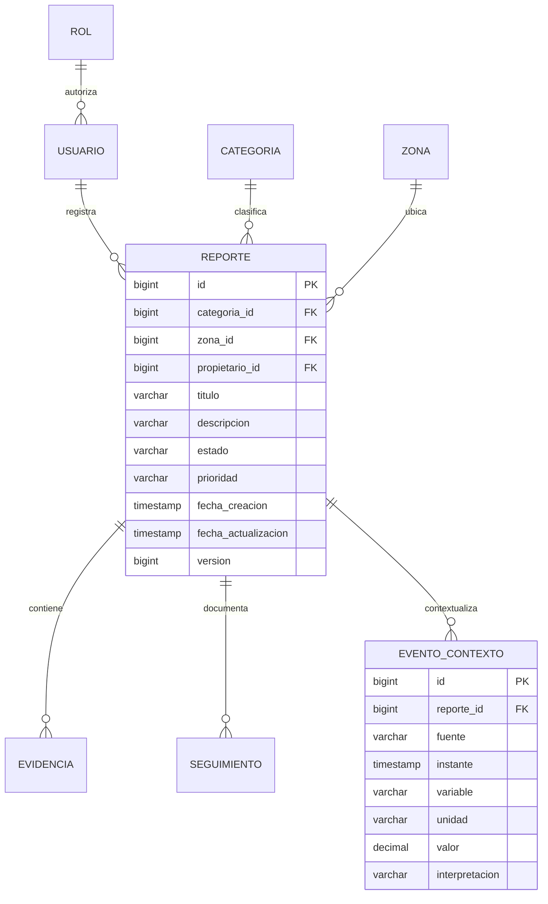

# Modelo PostgreSQL · PR07

DDL ejecutable: `BackendP04/src/main/resources/db/migration/V1__initial_schema.sql`. Catálogos sintéticos: `V2__initial_catalogs.sql`. Flyway aplica ambos en una base vacía y JPA valida el esquema; no usa ddl-auto=create en ejecución normal.

| Tabla | Responsabilidad / integridad |
| --- | --- |
| categoria | PK; nombre único y NOT NULL; activa; descripción sintética |
| zona | PK; nombre NOT NULL; referencia textual general; activa |
| reporte | PK; FK de categoría/zona/propietario; título y descripción NOT NULL; CHECK de cinco estados y tres prioridades; fechas; versión para bloqueo optimista |
| evidencia | PK; FK reporte; tipo, referencia ficticia y fecha NOT NULL; descripción opcional |
| seguimiento | PK; FK reporte; estados, comentario, rol actor y fecha NOT NULL; solo se crea dentro de cambio autorizado |
| evento_contexto | PK; FK reporte; fuente/dispositivo, instante, variable, unidad y valor NUMERIC(19,6) NOT NULL; interpretación opcional |
| usuario (auxiliar) | PK; correo único NOT NULL; hash BCrypt; FK rol; habilitación y creación |
| rol (auxiliar) | PK; nombre único y CHECK con exactamente tres roles |

Seis entidades principales cumplen el rango 5–7 del PR07. Usuario y rol son soporte de seguridad; no se agregan flujos de administración. Las FK impiden registros huérfanos. No hay borrado en cascada ni borrado API. Los índices cubren propietario, filtros y colecciones por reporte. Reglas de transición y propiedad se implementan en servicio; no se presentan como CHECK SQL. `@Transactional` garantiza cambio/historial conjunto y `@Version` rechaza escritura concurrente.

Fechas se conservan como TIMESTAMP/LocalDateTime según backend original; el laboratorio debe mantener una zona horaria consistente. Migrar a UTC/Instant es una mejora posterior de contrato. Las longitudes DTO suelen ser más restrictivas que VARCHAR SQL; la API valida antes de persistir. La evidencia contiene una referencia textual, no bytes de archivo.
